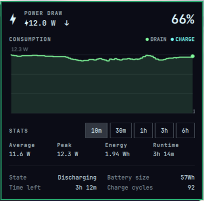
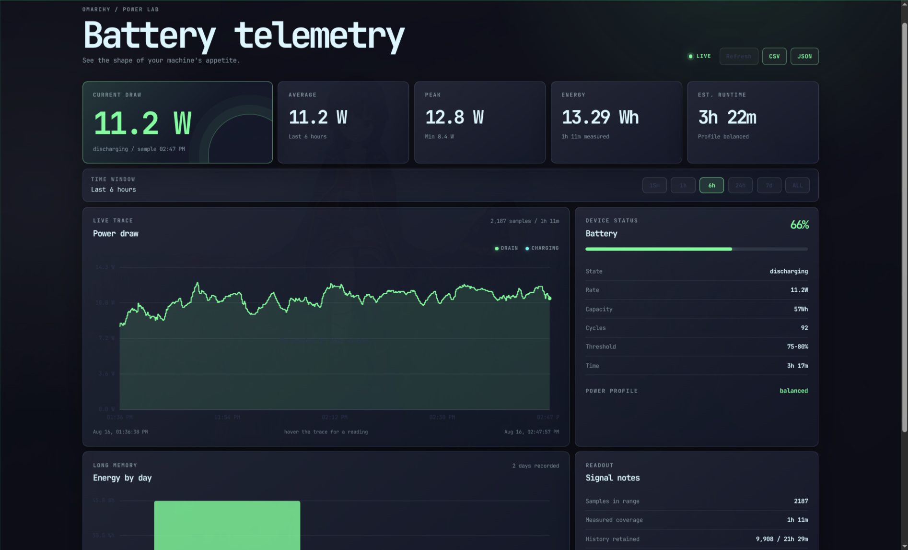

# Battery Usage

Omarchy bar widget showing the live battery draw (`󱐋<watts> W`). Left-click
opens a panel with a live consumption graph (drain and charge), averages,
peak, energy and battery details. Sampling history is kept in a local SQLite
database so it survives shell restarts, and an optional web dashboard can be
enabled to browse it.



## Install

```sh
omarchy plugin add https://github.com/OverStyleFR/omarchy-battery-usage.git --enable
```

## Usage

Click the widget to open or close the consumption panel. Press Escape to close
it. The panel shows:

- **Consumption** – live graph of drain and charge over the last 10 minutes.
- **Stats** – average, peak and energy for a selectable window (10m to 6h),
  plus an estimated runtime on battery.
- **Battery** – state, time left / time to full, battery size and charge
  cycles.

The widget only shows while a battery is present and the draw is non-zero
(hidden while idle on AC, kept visible while charging). Sampling cadence is 1s
on AC and follows the active power profile on battery (5s power-saver, 2s
balanced, 1s performance).

## Configure

Move the widget in your bar:

```sh
omarchy bar move tomv.battery-usage --section right
```

## Web dashboard (optional, disabled by default)

A small local dashboard (`webapp/`) browses the full history, daily energy
and CSV/JSON export. The server is **on-demand**: it starts when you open
the web app and stops again when you close its window.

```sh
~/.config/omarchy/plugins/tomv.battery-usage/scripts/battery-power-dashboard enable
```

This installs a **Battery Usage** launcher in the app menu
(SUPER + SPACE). Launching it runs checks (Python, sample database, free
port), starts the local server, opens the dashboard window, and stops the
server when the window closes.

Manage it from the terminal (the script is also linked into `$PATH` on this
system):

```sh
battery-power-dashboard status    # launcher/server/database state
battery-power-dashboard enable    # install the web app launcher
battery-power-dashboard disable   # remove the launcher and stop the server
battery-power-dashboard toggle    # flip between the two
battery-power-dashboard launch    # open the dashboard now, stop on close
```

Server state is kept in `~/.local/state/tomv.battery-usage/` (`server.pid`,
`server.log`). Defaults to `127.0.0.1:8090`; override with
`BATTERY_STATS_HOST` and `BATTERY_STATS_PORT`. It reads the same database as
the widget.



## Dependencies

- Omarchy shell (`omarchy-battery-status`, `omarchy-powerprofiles-list` are
  shipped with Omarchy).
- `sqlite3` CLI for sample persistence.
- Python 3 (standard library only) for the optional web dashboard.

Data is stored in `~/.local/state/tomv.battery-usage/power.db`.

## Remove

```sh
omarchy plugin remove tomv.battery-usage
```

Removing the plugin does not delete the sample database.

## License

MIT
